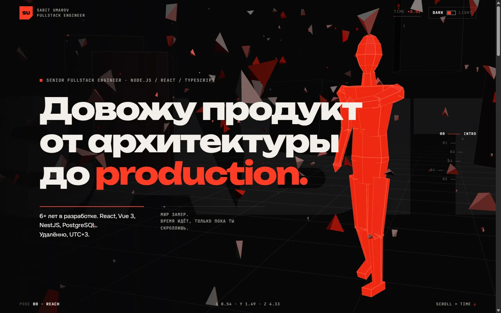
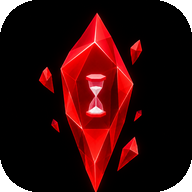
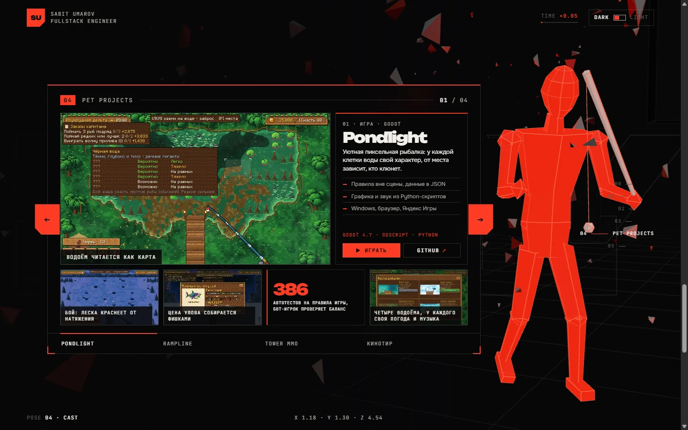
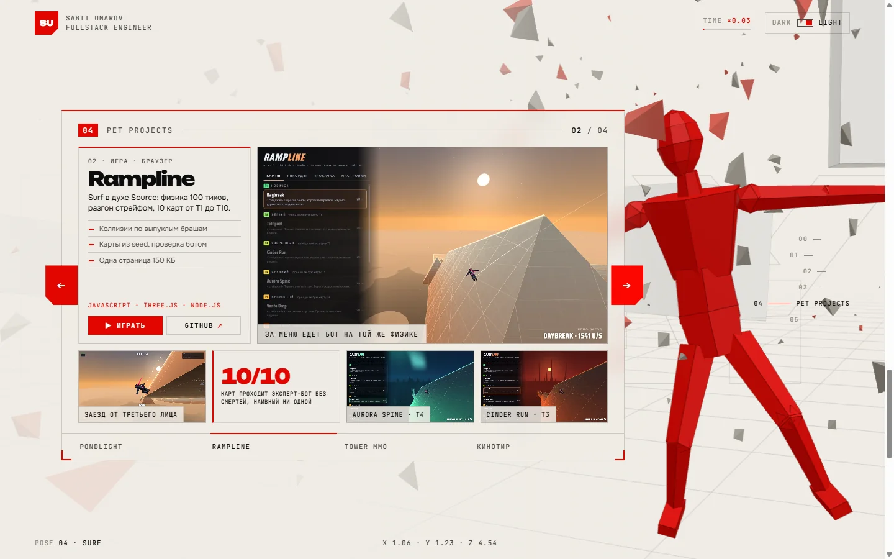
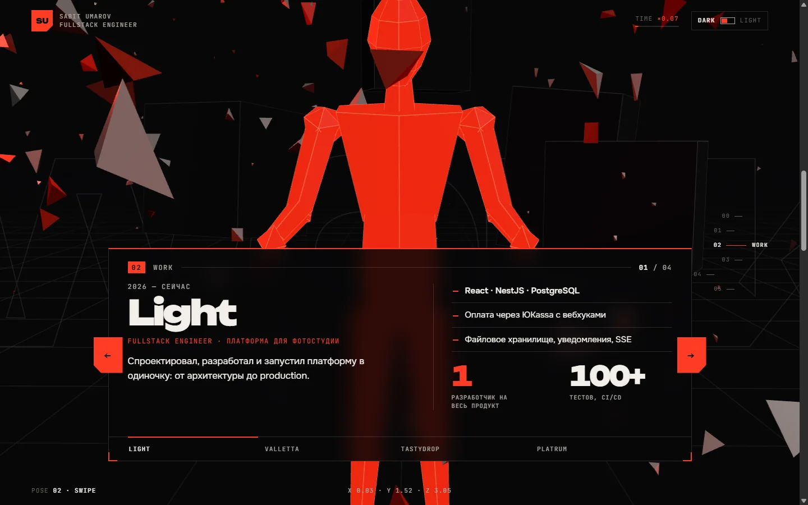
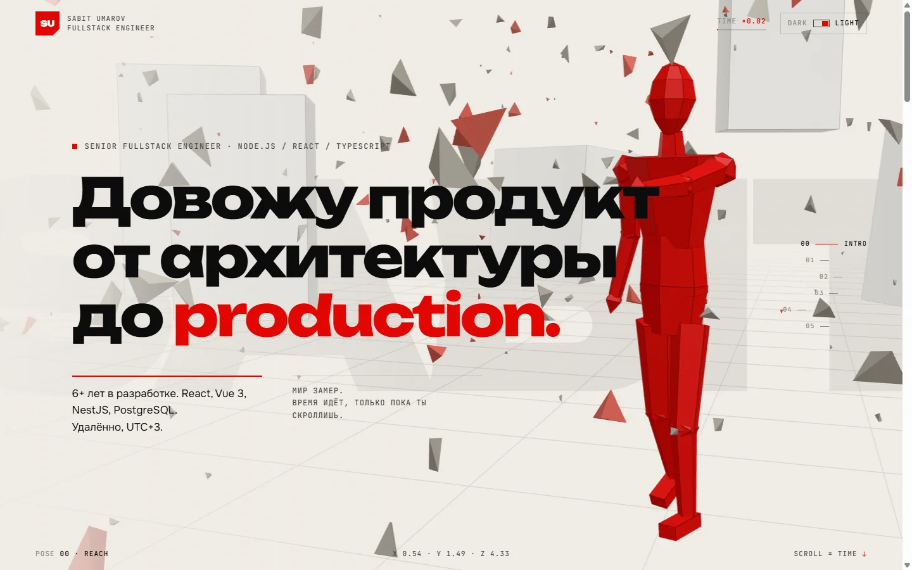
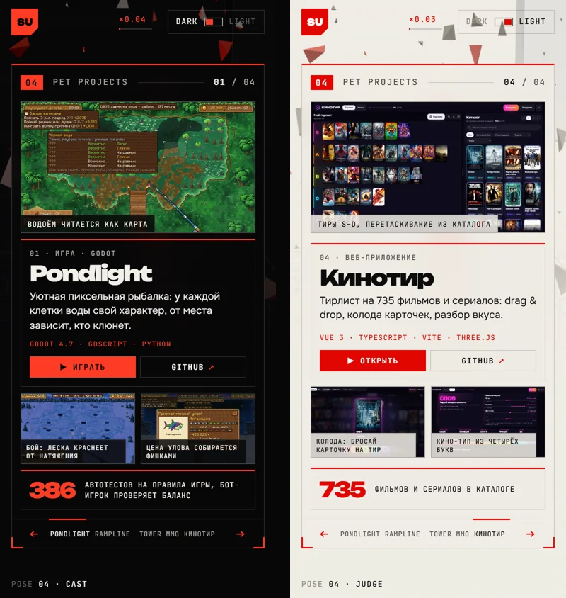

<p align="center"></p>

<p align="center"></p>

<h1 align="center">x1as.github.io</h1>

<p align="center">
  <b>Портфолио, где мир замер, а время идёт, только пока ты скроллишь.</b><br>
  <i>A portfolio where the world is frozen and time moves only while you scroll.</i>
</p>

<p align="center">
  
  
  
  
</p>

<p align="center">
  <a href="https://x1as.github.io/"><b>▶ Открыть сайт</b></a> &nbsp;·&nbsp; <a href="#english">English</a>
</p>

> **В двух словах.** Посреди замёрзшего облака осколков стоит низкополигональная фигура. Скролл двигает время: осколки оживают, камера облетает фигуру, а она меняет позу под каждый раздел. В опыте работы она смахивает слайды рукой, а в pet-проектах рассыпается на осколки и собирается в позу следующего проекта: рыбак, серфер, строитель, критик.

## Под капотом

| | |
|---|---|
| ⏱ **Время от скролла** | скорость прокрутки разгоняет `timeScale`, весь мир (осколки, дрейф камеры, дыхание фигуры) живёт в этом «времени», в покое оно почти стоит |
| 🧍 **Фигура из примитивов** | скелет из суставов, позы задаются углами и смешиваются по прогрессу скролла; разлёт тела, жест листания и сборка в новую позу считаются поверх позы |
| 🖼 **Галерея-коллаж** | для каждого проекта своя сетка из 12 колонок: большой кадр, колонка текста и полоса из четырёх плиток; плитки въезжают шторкой со стороны листания, размеры считаются в `cqw` от ширины галереи |
| 🌗 **Две темы** | вёрстка на CSS-токенах, у 3D-сцены своя палитра на тему; при переключении цвета сцены плавно перетекают |
| 📱 **Телефон и планшет** | своя раскладка галереи, фигура уходит за подложку, свайп листает слайды |
| 🪶 **Без сборки** | `index.html`, `styles.css`, `main.js`; three.js подключается через import map |

## Галерея

<table>
  <tr>
    <td width="50%"><br><sub><b>Pet projects.</b> Коллаж на проект, фигура-рыбак с удочкой.</sub></td>
    <td width="50%"><br><sub><b>Светлая тема.</b> Та же сцена, серфер на Rampline.</sub></td>
  </tr>
  <tr>
    <td><br><sub><b>Опыт.</b> Фигура держит панель и смахивает слайды.</sub></td>
    <td><br><sub><b>Первый экран.</b> Светлая тема.</sub></td>
  </tr>
  <tr>
    <td colspan="2" align="center"><br><sub><b>Телефон.</b> Галерея в обеих темах.</sub></td>
  </tr>
</table>

## Запуск

```bash
node serve.mjs     # http://localhost:4173
```

Сайт отдаётся GitHub Pages прямо из `main`, сборки нет.

## Структура

| Файл | Что внутри |
|---|---|
| `index.html` | разделы: интро, профиль, опыт, стек, pet-проекты, контакты |
| `main.js` | сцена three.js, фигура и позы, время от скролла, карусель опыта, галерея проектов |
| `styles.css` | токены тем, раскладка разделов, галерея, адаптив |
| `img/pets/` | скриншоты проектов для галереи |
| `serve.mjs` | локальный сервер для просмотра |

---

<a id="english"></a>
## English

A personal portfolio built as a single 3D scene. A low-poly figure stands in a frozen cloud of shards; scrolling drives time, so the world comes alive, the camera orbits and the figure changes pose for each section. In the pet projects gallery it shatters into shards and reassembles into a pose for the next project. Three.js through an import map, vanilla JS and CSS, no build step, dark and light themes, phone and tablet layouts.

▶ **[Open the site](https://x1as.github.io/)**

---

<p align="center"><sub>Сделано <a href="https://github.com/x1as">@x1as</a> · 2026</sub></p>
